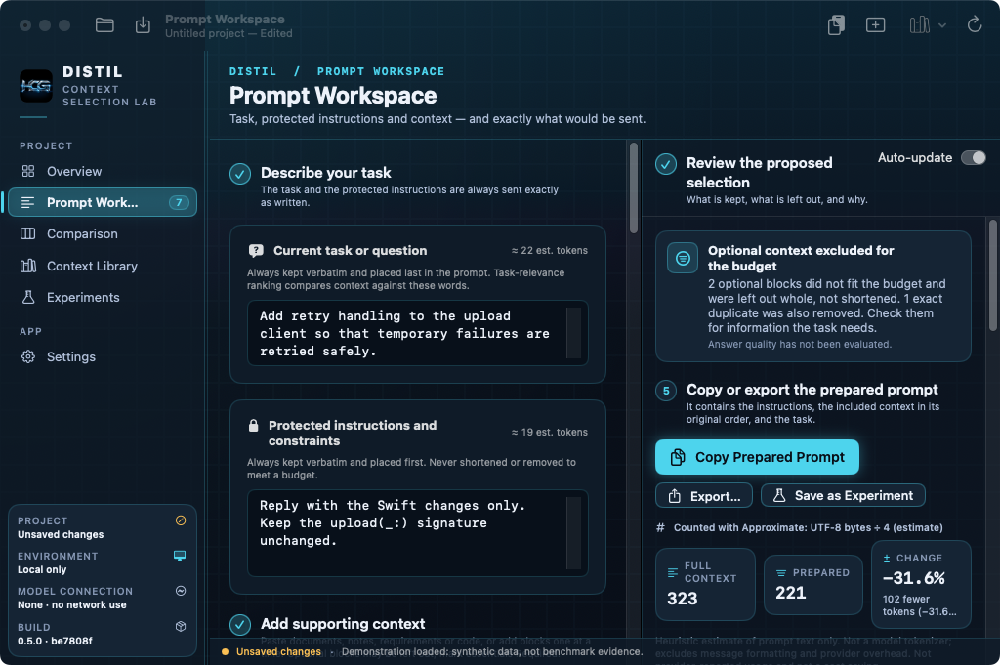
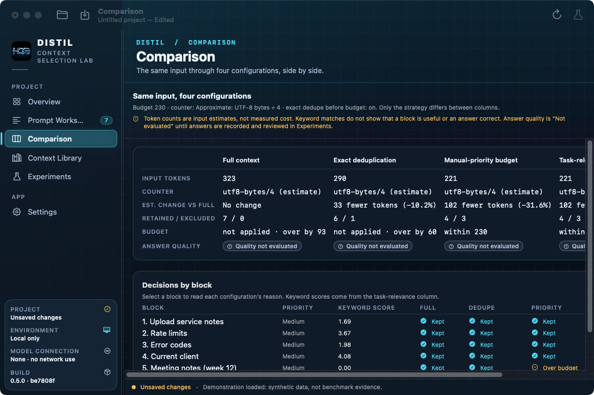
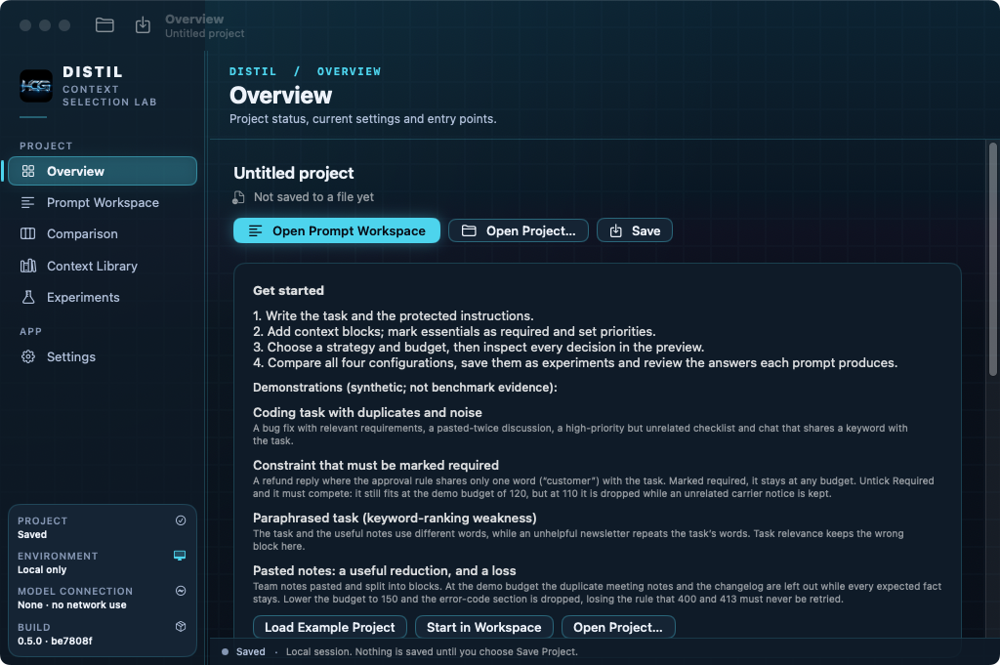
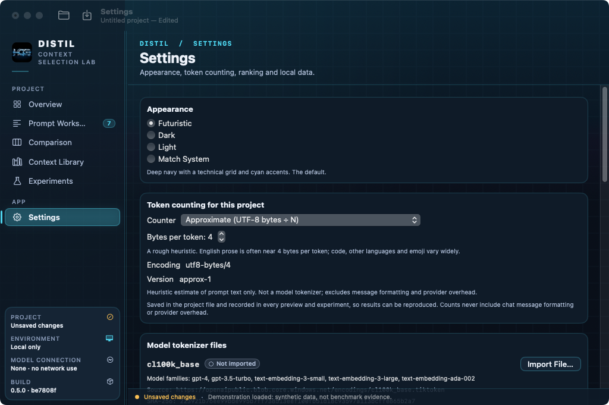
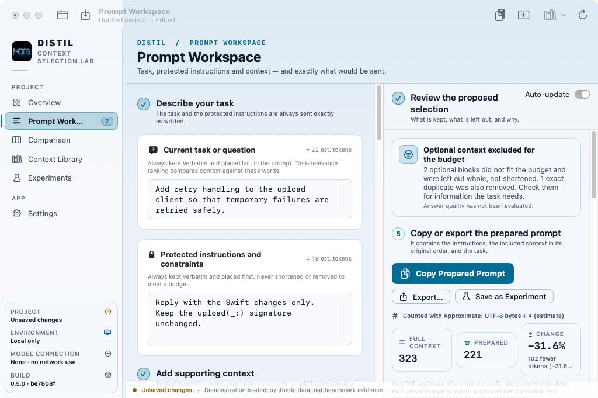

# Distil — native macOS prototype 0.5

Distil helps you send a model less unnecessary context while keeping what a task needs, and then check whether the answer is still useful. It is a SwiftUI desktop app whose icon and sidebar mark use the HCG logo (the hackathon organiser’s). All source is newly written for this project; apart from that logo, no company code, logos, assets, accounts or third-party packages are included.

A smaller prompt is not automatically a better prompt. Every number names the counter that produced it. Estimated reductions are never presented as cost savings, keyword matches are never presented as understanding, and answer quality stays "Not evaluated" until you compare real answers.

**Names:** the app, executable and Xcode scheme are all **Distil**. The package and modules keep their internal names (`TokenLab`, `TokenLabCore`, `TokenLabApp`), and so does the bundle identifier (`dev.tokenlab.prototype`). Preferences, imported tokenizer files and saved projects therefore carry over.

## Screenshots

Real window captures of the packaged `Distil.app`, taken by the Distil workflow on GitHub's macOS runner. The project is the synthetic *Pasted notes* demonstration.

**Prompt Workspace**: the task, protected instructions and context, and the proposed selection, which keeps 221 of 323 estimated tokens and says what was left out. *Captured 8 November 2026.*



**Comparison**: the same input through four configurations, side by side. Answer quality stays "Not evaluated" until real answers are reviewed. *Captured 8 November 2026.*



<details>
<summary>More screens: Overview, Settings and the Light appearance (same run)</summary>

| | |
|---|---|
|  |  |
| **Overview**, empty project | **Settings** |
|  | |
| **Prompt Workspace**, Light appearance | |

</details>

<sub>**Screenshot provenance:**
- Source: Distil workflow [run 42517732768](https://github.com/F1r3srp3nt/The-Last-Sprint/actions/runs/42517732768) on `main` at commit `be7808f6f165544f8f8a9737d0905ee237643873`, which includes the HCG logo as the app icon and sidebar mark (The-Last-Sprint PR #5).
- Captured on 8 November 2026 (about 20:04 UTC). The app is version 0.5.0, and its Build card shows `be7808f`.
- The runner's screen is 1024×768, so the window is close to its minimum size.
- The images are unedited copies of the CI artifact.</sub>

**Packaged builds** for the competition go in [`submissions/Distil/`](../submissions/Distil/README.md). That folder says whether a build has been uploaded and what was verified.

## Build and launch the latest Distil

Requirements: macOS 14 or later, Xcode 15 or later (Swift 5.9+). No dependencies, API keys or network access are needed. Every script works from any folder.

**Recommended: build the app bundle and open exactly that copy**

```sh
bash distil/scripts/run-latest.sh            # or, inside distil/: bash scripts/run-latest.sh
bash distil/scripts/run-latest.sh --test     # run the tests first and stop if they fail
```

This checks the developer tools, packages `dist/Distil.app` (version 0.5.0, with the current git commit and build time), and opens that exact copy. Nothing is opened unless every step succeeded. If a copy of Distil is already running, it asks that copy to quit first. That matters because `open` only brings a running app to the front; it doesn't start the new build. If you cancel the quit, the script stops and launches nothing. After opening, it confirms the app is still running, so a launch crash is reported as one.

**Separate steps**

```sh
bash scripts/check-prereqs.sh --tests   # read-only check of macOS, Swift, developer directory, SDK, XCTest
bash scripts/test.sh                    # tests only; prints how many ran, were skipped and failed
bash scripts/build-macos.sh             # package only; never compiles the test targets
swift run Distil                        # run from SwiftPM; menu bar and Dock show "Distil"
```

Tests need XCTest, which comes with full Xcode. With only the Command Line Tools selected, `swift test` fails with `no such module 'XCTest'`: that is the test build failing, not the app. `check-prereqs.sh --tests` prints the fix (for example `DEVELOPER_DIR=/Applications/Xcode.app/Contents/Developer bash scripts/test.sh`) and never changes your selection. Packaging works with the Command Line Tools.

**Xcode:** open `Package.swift`, choose the **Distil** scheme and **My Mac**, then Product → Test (⌘U) or Run (⌘R).

**Confirm which build is running:** Settings (⌘,) → *About this build* shows the version, build number, configuration and git commit. It also shows the build time and where the running app was launched from. `swift run` and Xcode show "Unbundled executable" and the executable's modification time instead of a commit.

**Optional model tokenizer files:** download `o200k_base.tiktoken` or `cl100k_base.tiktoken` yourself from the addresses shown in Settings, then import the file there. A file is accepted only if its SHA-256 matches the published value. To run the reference tokenizer tests as well:

```sh
TOKENLAB_ENCODINGS_DIR=/folder/with/tiktoken/files bash scripts/test.sh
```

## Appearance (Futuristic skin)

Distil and Relay share one original design: a deep navy canvas with a faint technical grid, navy
panels with thin cyan borders, a filled teal sidebar selection with a cyan indicator, cyan breadcrumbs
above bold page titles, cyan primary buttons with dark text, and themed fields and secondary buttons.
**Futuristic** is the default appearance. Settings › Appearance also offers Dark (no grid or glow),
Light and Match System. Installations that were on "Match System" move to Futuristic once; an
explicit Dark or Light choice is kept. The sidebar's Build card shows which copy is running.

The skin has not yet been viewed on a Mac. Build, launch and check it with
`../relay/docs/SKIN-VERIFICATION.md` (it covers both apps).

## Using the Prompt Workspace

The workspace walks through five steps:

1. **Describe your task.** Write the task and the protected instructions; both are sent exactly as written.
2. **Add supporting context.** Use **Paste Context…** for documents, notes, requirements or code, or add blocks one at a time.
3. **Choose a strategy and budget.** The budget covers the whole prepared prompt.
4. **Review the proposed selection** in the right-hand panel:
   - An outcome banner says exactly what happened. It is one of: "No context to optimise", "Full context: everything retained", "Nothing removed by this strategy", "Exact duplicates removed", "Optional context excluded for the budget" or "Protected content exceeds the budget".
   - Token counts name the counter used, and the change is shown as a reduction or an increase.
   - Blocks are listed as Included or Left out. Click one to see its full text and the reason; **Mark Required and Update** keeps it and runs the selection again.
5. **Copy or export.** Use **Copy Prepared Prompt** (⇧⌘C), Export, or Save as Experiment.

**Paste Context:**
- Choose **Keep as one block** or **Split into blocks**, then preview the blocks, rename them, set categories and mark essential ones Required before adding.
- Splitting is deterministic. It splits at Markdown headings when there are any (text before the first heading is its own block), otherwise at blank lines between paragraphs.
- Fenced code (``` or ~~~) is never split, even across blank lines.
- Every block is an exact run of whole lines from the paste: nothing is rewritten, summarised or shortened. Only the blank lines between blocks are left out.
- The complete original is kept in the project under **Pasted originals**, where you can view or copy it.

## Demonstration (synthetic, not benchmark evidence)

File → Load Demonstration → **Pasted notes: a useful reduction, and a loss**. These notes were written for this project and pasted as one Markdown document. They split into seven blocks: intro, rate limits, error codes, the current client code (with an internal blank line kept), meeting notes pasted twice, and a changelog.

1. **Useful reduction (budget 230, task relevance, dedupe on):**
   - The duplicate meeting notes, the original meeting notes and the changelog are left out, taking the estimate from 323 to 221 tokens.
   - The rate limits, error codes and client code all stay, so every expected fact is still in the prompt.
2. **Information loss (set the budget to 150):**
   - The **Error codes** block is left out, losing the rule that 400 and 413 must never be retried.
   - The outcome banner still says only "Optional context excluded for the budget". Nothing in the numbers tells you a needed fact is gone, which is why reviewing what was left out matters.
   - Click **Error codes** under *Left out* and choose **Mark Required and Update** to bring it back.

The other demonstrations show a mixed coding task, a constraint that must be marked Required, and a paraphrased task where keyword ranking keeps the wrong block. None of them measures answer quality.

## Features

- **Sections:** six of them, switched from a persistent sidebar (⌘1–⌘6): Overview, Prompt Workspace, Comparison, Context Library, Experiments and Settings.
  - **Resizing the sidebar:** drag the thin handle at its edge (180–280 points). The width is remembered and automatically reduced if the window is too narrow.
- **Strategies:** Full context; Exact deduplication; Manual-priority budget; Task-relevance budget (local keyword overlap, with its limitations shown).
  - **Protected content:** the task, the instructions and Required blocks are always kept verbatim.
  - **Budget:** it covers the whole assembled prompt. Retained blocks keep their original order.
- **Comparison:** all four strategies on the same input. Saved as linked, reproducible experiments.
- **Experiments and evaluation:**
  - **Answers:** you record answers for the full-context and selected prompts manually. Each answer records where it came from and which saved prompt it belongs to.
  - **Invalidation:** editing an answer or a criterion clears the verdict and the affected check results; editing notes doesn't.
  - **Sharing a reference:** it only fills completely empty references in the same comparison, and only when the saved prompts are byte-identical.
  - **Provider token counts:** compared only when provider and model labels match.
- **Token counting:** a labelled approximation, or verified `cl100k_base`/`o200k_base` vocabularies. No network access.
- **Project files:** versioned JSON.
  - **Opening:** files are validated before your current work is replaced. Older formats still open.
  - **Unsaved changes:** New, Open, demos, closing the window and Quit all ask Save / Don't Save / Cancel.
  - **Credentials:** saving and exporting warn when text looks like a credential.

## Verification status

| Check | Where | Result |
|---|---|---|
| Core library + tests compile | Linux, Swift 5.10.1 | Pass, no warnings |
| `swift test` with the official tokenizer files | Linux, Swift 5.10.1 | **125 passed, 0 failed** |
| `swift test` without tokenizer files | Linux, Swift 5.10.1 | 125 run, 3 skipped, 0 failed |
| BPE tokenizer vs tiktoken 0.14.0 | Linux | 0 mismatches on 8,000 comparisons (tokenizer unchanged since) |
| SwiftUI app compiles | macOS 15, GitHub Actions | Pass (Distil workflow, macOS job) |
| App launches and draws each section | macOS 15, GitHub Actions | Window screenshots captured (see [Screenshots](#screenshots)) |
| **Interaction, menu bar/Dock name, sidebar resizing, sheets, shortcuts, contrast** | — | **Not verified: needs a person on a Mac** |

**CI screenshots:** the Distil workflow's macOS job launches the built app and saves window captures as the `distil-screenshots` artifact on each run: an empty project, every section with the *Pasted notes* demonstration loaded, and the workspace in Light. CI opens these screens with `--screenshot-demo <demo>` and `--screenshot-section <section>`; ordinary launches pass neither. A capture shows how a screen draws, not that it works.

## First-launch checklist (on your Mac)

1. Run `bash scripts/run-latest.sh --test`. Tests pass, and Settings → About shows 0.5.0 (build 5) and the current commit.
2. The menu bar, Dock, window and About menu all say **Distil**. `swift run Distil` shows Distil too.
3. **Sidebar repro:**
   - Overview → Comparison with an empty project. Then load a demonstration and go Overview → Comparison again. The sidebar rows stay visible both times.
   - Repeat after clicking into editors and resizing the window to its minimum (760×520).
4. Paste a document with headings and a fenced code block. Preview shows one block per section, and the code is intact. Name a block, mark one Required, add them, then check **Pasted originals** holds the exact text.
5. Follow the demonstration above: budget 230 shows the useful reduction, budget 150 shows the loss, and Mark Required restores the block.
6. With Full context selected, the banner says "everything retained"; with nothing removable, it says "Nothing removed". Neither claims a reduction.
7. In Experiments → Evaluation:
   - Edit an answer: the verdict and that answer's checks clear.
   - Edit notes: the verdict stays.
   - The provider comparison needs matching labels.
8. Save, quit and reopen: pasted originals, provenance and evaluations round-trip. Opening a 0.4 project still works.

## Known limitations

- **Splitting:** it is line-based Markdown awareness, not a full Markdown parser. Lists, tables and HTML are split only at blank lines and headings. Setext headings must be a single line.
- **Ranking:** keyword ranking matches exact words only. Budget filling is greedy.
- **Reveal in Workspace:** "Edit in Workspace" scrolls the editor to the block. It does not move keyboard focus.
- **Large files:** opening and saving projects runs on the main thread.
- **Answers:** you enter them by hand; there are no live model calls.
- **Older builds:** `run-latest.sh` can only quit bundled copies. A copy started with `swift run` must be quit by hand.

## Layout

- **`Sources/TokenLabCore`** (no UI):
  - `Models`: draft and strategies.
  - `SelectionEngine`: selection, outcomes and the latest-result gate.
  - `ContextImport`: splitter and pasted originals.
  - `Relevance`, `Comparison`.
  - `TokenCounting`, `BPETokenizer`, `SHA256`.
  - `Evaluation`: centralised review editing, provenance, reference sharing.
  - `ProjectDocument`: schema and migrations.
  - `ProjectSession`, `DemoDataset`, `SampleProject`, `SecretScanner`, `ProviderAdapter`.
- **`Sources/TokenLabApp`** (macOS only): SwiftUI views, the store and the design system.
- **`Tests/TokenLabCoreTests`:** 125 tests.
- **`scripts/`:** `build-macos.sh` (builds `dist/Distil.app`) and `run-latest.sh` (build, quit the old copy, open the new one).
