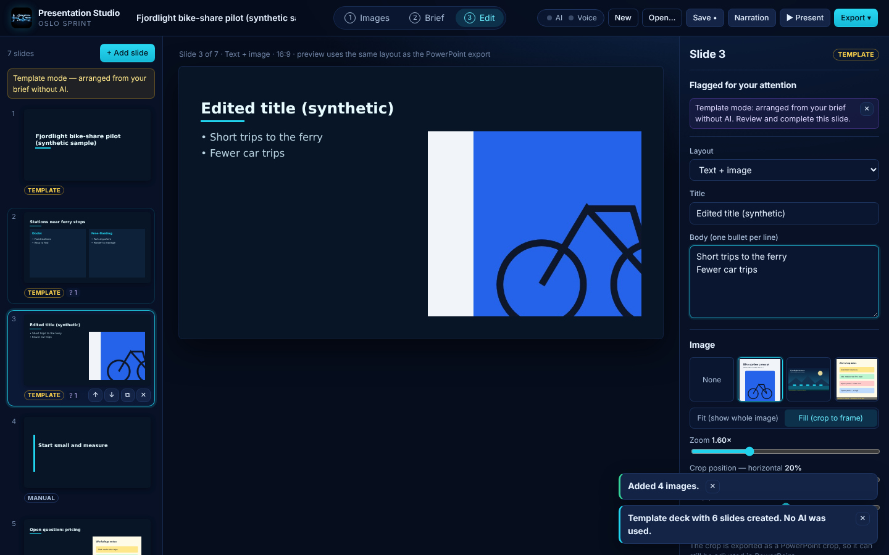
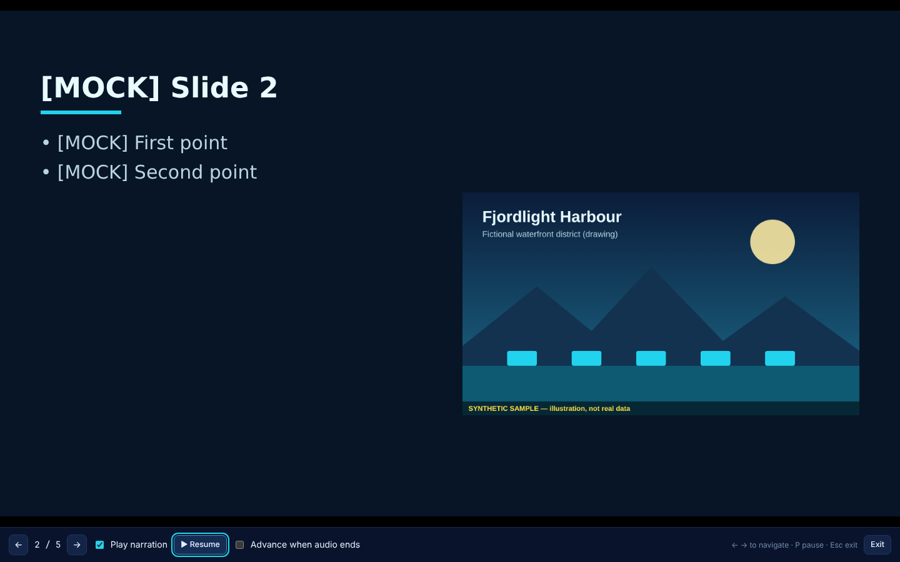
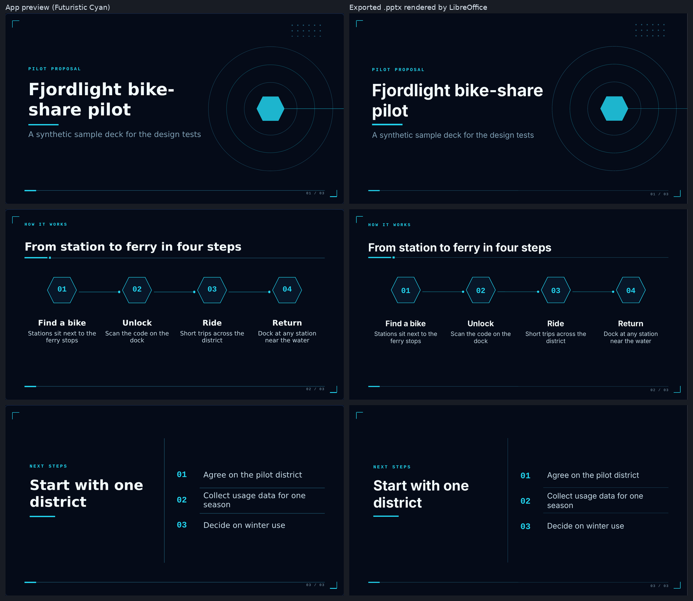

# Presentation Studio

An Oslo Sprint product (working name). You upload images and describe your topic, audience, key points and style, and it builds an **editable PowerPoint deck**. Optional ElevenLabs features let you **speak the brief** instead of typing it and **narrate slides** from their speaker notes.

Presentation Studio is a standalone web app: a React + TypeScript interface and a small Node/Express backend that holds the provider keys. It shares no code with Distil or Relay.

## Screenshots

These are **browser screenshots**: Chromium driven by Playwright in the end-to-end test, not a packaged desktop app. All content is synthetic.

**Slide editor**: slide list, 16:9 preview (the same layout as the PowerPoint export) and the properties panel, in template mode (no AI). The deck is a synthetic sample. *Captured 8 November 2026.*



**Presentation mode**: full-screen preview with narration controls. The slide text comes from the test's **mock** AI provider, which labels it `[MOCK]`; no real model was called. *Captured 8 November 2026.*



<sub>**Screenshot provenance:**
- Source: `npm run test:e2e` (the same end-to-end test the workflow's `e2e` job runs), on `main` at commit `80cd784e430c08553fa68674cbabe612bbc0a0e2`, which includes the HCG logo in the top bar (The-Last-Sprint PR #5). Run locally on Linux because the CI artifact could not be downloaded from the build environment; that test passed in CI on the same commit ([run 42517825583](https://github.com/F1r3srp3nt/The-Last-Sprint/actions/runs/42517825583)).
- Captured on 8 November 2026 (about 20:10 UTC) in headless Chromium at 1440×900.
- The images are unedited copies of the test output (`a2-editor.png`, `b4-present.png`).</sub>

## Desktop app

Presentation Studio also runs as a standalone desktop app: `Presentation Studio.app`, opened by double-click, with its own window. It needs no Terminal, browser, npm or Node.js on the user's Mac. Keys are entered in the app's Setup and stored with the macOS Keychain. See [`docs/DESKTOP.md`](docs/DESKTOP.md) for how it works, the security model, and how to build the Apple Silicon `.app` and DMG (`npm run desktop:dist:mac`). The app is ad-hoc signed only, not notarised.

**Packaged builds** for the competition go in [`submissions/Presentation Studio/`](../submissions/Presentation%20Studio/README.md). Presentation Studio currently runs from source as a web app; that folder says whether any package has been uploaded.

## Quick start

Requires **Node.js 22.12 or newer** (needed by Vite 8 and Vitest 5) and npm.

```bash
cd presentation-studio
```

```bash
npm install
```

```bash
cp .env.example .env
```

Edit `.env` if you want AI generation or voice features (see [Configuration](#configuration)). With no keys you get template mode, editing and PowerPoint export.

```bash
npm run dev
```

Open http://127.0.0.1:5173. The API server runs on http://127.0.0.1:8787, and Vite proxies `/api` to it.

To run a production build from one port:

```bash
npm run build
```

```bash
npm start
```

Then open http://127.0.0.1:8787.

| Script | What it does |
|---|---|
| `npm run dev` | API server (auto-restart) + Vite dev server |
| `npm run build` | Type-checks the client and server, then builds the client into `dist/` |
| `npm start` | Serves `dist/` and the API on one port (`PORT`, default 8787) |
| `npm test` | Unit and API tests (Vitest) |
| `npm run test:e2e` | Browser end-to-end test (Playwright + Chromium, mock providers) |
| `npm run typecheck` | TypeScript only |
| `npm run samples` | Regenerates the synthetic sample images in `samples/` |
| `npm run desktop:dev` | Builds and opens the desktop app unpackaged (see [docs/DESKTOP.md](docs/DESKTOP.md)) |
| `npm run desktop:pack` | Packages the desktop app for the current platform into `release/` |
| `npm run desktop:dist:mac` | On a Mac: Apple Silicon `.app` and DMG |
| `npm run desktop:test` | End-to-end test of the packaged desktop app |
| `./scripts/check-no-secrets.sh` | Fails if a `.env` file or something that looks like a real API key is tracked by git |

## How it works

1. **Images.** Drag and drop PNG, JPEG or WebP images (several at once). Reorder them, remove them, add captions, and pin an image to a slide number or leave the placement to the generator. Originals are stored byte-for-byte and are never stretched.
2. **Brief.** Fill in the topic, brief and key points, audience, language, slide count and tone, and choose whether to write speaker notes. Pick one of three deck themes. You can also record the brief (see [Spoken brief](#spoken-brief)).
3. **Create the deck**, in one of two modes:
   - **AI generation.** A notice first says exactly what goes to the provider. Generation then plans an outline, then writes each slide, with per-slide progress, retry and stop controls.
   - **Template mode (no AI).** This mode arranges your own points and images into slides. It never writes new content. Each slide is labelled **Template** and the deck shows a "without AI" banner.
4. **Edit.** On the left are slide thumbnails (select, drag or arrow to reorder, duplicate, delete, add). In the centre is the 16:9 preview. On the right you edit the layout, text, image (fit or fill, zoom and crop position), speaker notes and narration, or rewrite this one slide with AI.
5. **Export** an editable `.pptx`, or `.pptx` + narration as a ZIP. **Save** writes a `.pstudio` project file, and **Open** reopens it.

Layouts: title, image with caption, text + image, full image, comparison, key takeaway, closing.
Deck themes: clean light, executive dark, futuristic cyan. They are kept separate from the midnight-navy and cyan app interface.

## Configuration

All configuration lives in `presentation-studio/.env`, which git ignores. Copy `.env.example`.

| Variable | Purpose | Default |
|---|---|---|
| `ANTHROPIC_API_KEY` | Enables AI generation. Create one at https://platform.claude.com/settings/keys | unset → template mode |
| `ANTHROPIC_MODEL` | Generation model (image-capable) | `claude-opus-5-5` |
| `ANTHROPIC_EFFORT` | `low`/`medium`/`high`/`xhigh`/`max` | `medium` |
| `ANTHROPIC_REFUSAL_FALLBACK` | `default` uses Anthropic's server-side refusal fallback; `off` disables it | `default` |
| `GENERATION_PROVIDER` | `none` forces template-only mode | auto |
| `ELEVENLABS_API_KEY` | Enables the spoken brief and narration | unset → voice features off |
| `ELEVENLABS_TTS_MODEL` | Narration model | `eleven_multilingual_v2` |
| `ELEVENLABS_STT_MODEL` | Transcription model | `scribe_v2` |
| `PORT`, `HOST` | API server address | `8787`, `127.0.0.1` |

Restart the server after changing `.env`. The **AI / Voice** pill in the top bar opens **Setup**. Its dots mean: grey = not configured, amber = key configured but connection not verified, green = verified, red = the last check failed. **Key configured** and **Connection verified** are reported separately.

**Keys stay on the server.** They are never sent to the browser or stored in browser storage. They are not written into project files or exports, and the server never logs them: it logs only error codes and request sizes. The e2e test checks the page, browser storage, the `/api/status` response, saved projects, exported ZIPs and the server log for the keys.

## AI generation

- **Provider:** Anthropic Messages API through the official `@anthropic-ai/sdk`, with structured outputs (`output_config.format` with a Zod schema). The default model is `claude-opus-5-5`. The server-side refusal fallback (`fallbacks: "default"`, beta `server-side-fallback-2026-07-01`) is **on by default**; set `ANTHROPIC_REFUSAL_FALLBACK=off` to turn it off.
- **Two steps:** (1) an outline with layouts, image assignments, per-image notes and a deck-level "missing information" list; (2) each slide's content, written separately so a single failed slide can be retried.
- **Images:** the browser sends a downscaled JPEG copy (max 1568 px on the long edge) of each image. The original upload is never modified.
- **Trust boundary:** the brief is the only source of instructions. Images, captions, file names and any text inside images are wrapped as *source material*, and the model is told not to follow instructions found there. `samples/poster-with-embedded-instruction.png` is a test image for this.
- **No invented facts:** the prompts forbid invented facts, statistics, sources and quotations. Gaps are returned as **flags**, which the editor shows per slide ("Flagged for your attention").
- **Validation:** the server validates the model's JSON (schema, layouts, image references, counts), and the browser validates it again before rendering. Invalid output, refusals, truncation, rate limits, network errors and authentication problems each produce a specific message and, where useful, a **Retry** button.
- **Rewrite one slide:** in the editor, *Rewrite this slide with AI* (with an optional instruction) replaces only that slide's text.

## PowerPoint export

- Real, editable **text boxes**, **pictures** and **speaker notes** built with [PptxGenJS](https://github.com/gitbrent/PptxGenJS) 4.0.1. Slides are not rendered as images.
- **Same layout as the preview:** `src/shared/render.ts` turns each slide into positioned elements (inches, points). The React preview and the exporter draw those same elements. Font sizes are chosen once by a shared, deliberately conservative text-fit estimate (`src/shared/textFit.ts`).
- **Images are never stretched.** *Fit* shows the whole image. *Fill* covers the frame and is written as a native PowerPoint crop (`srcRect`), so you can still adjust it in PowerPoint. PNG and JPEG are embedded unchanged. WebP is converted to PNG (lossless) for compatibility with older PowerPoint versions, and the project file keeps the original WebP.
- **Overflow:** text that does not fit even at the minimum size produces a warning on the slide, a ⚠ badge on its thumbnail, and a confirmation before export.
- Fonts are Arial, Georgia and Trebuchet MS. PowerPoint substitutes them if they are not installed.



## Project files (`.pstudio`)

A ZIP file containing `project.json` (slides, brief, theme, image metadata, narration metadata), `assets/` (original uploads, byte-for-byte) and `audio/` (narration MP3s). Opening one validates the JSON and reports any missing files. Project files contain no credentials.

## ElevenLabs features

ElevenLabs handles **transcription and narration**. The generation model handles slide planning, image interpretation and writing. The two are configured and reported separately. If ElevenLabs is not configured or fails, editing and PowerPoint export still work.

### Guided setup

1. Sign in at [elevenlabs.io](https://elevenlabs.io/app) and open [Settings → API keys](https://elevenlabs.io/app/settings/api-keys). Create a key. (ElevenLabs notes that creating personal keys requires a full seat in a workspace.)
2. If you restrict the key's endpoints, allow **Text to Speech**, **Speech to Text** and reading **Voices**. Reading **User** is optional: it lets the app show your credit balance. You can also give the key a **credit limit**.
3. Put the key in `.env` as `ELEVENLABS_API_KEY=…` and restart the server.
4. Open **Setup → Verify connection**. This lists voices and reads your credit balance, which costs no credits. It does **not** test speech-to-text or text-to-speech, because each test call would use credits; those are checked on first use.
5. Open **Narration**, play voice samples and choose a voice. To use more voices, add them to *My Voices* from the [Voice Library](https://elevenlabs.io/app/voice-library).

**Credits:** transcription and narration both use ElevenLabs credits, and narration is billed per character. The app always asks before sending audio or text, and it shows the character count first. Voice previews play ElevenLabs' sample clips (`preview_url`) and do not generate audio.

### Spoken brief

Recording is explicit: you press **Start recording** and **Stop** (maximum 5 minutes). Nothing is uploaded until you press **Transcribe (uses credits)**. The transcript then appears for editing. You choose **Use as brief (replace)**, **Append to brief** or **Discard**. Typing always works without ElevenLabs.

### Narration

- Narration is generated from each slide's **speaker notes**, for one slide (*Generate narration*) or the deck (*Narration → Narrate N slides*, either missing/outdated slides only or all slides). Each run needs an explicit confirmation that shows the character count.
- Each slide's narration can be played inline, regenerated or removed.
- If the speaker notes change after audio was generated, the narration is marked **Outdated**.
- **Presentation mode** (▶ Present) has optional *Play narration*, pause/resume, manual navigation (← →, click) and optional *Advance when audio ends*.
- **Export → PowerPoint + narration (.zip)** contains the `.pptx`, `narration/slide-NN.mp3` and `narration/mapping.json` / `mapping.csv`. The mapping covers each slide, its audio file, its status (`ready`/`outdated`/`missing`/`no-notes`), the voice and the model.
- **Audio is not embedded in the .pptx.** PptxGenJS can add audio media (`addMedia`), but playback in PowerPoint has not been verified, so the app does not offer it.

### Error handling

The app gives specific messages and next steps for: invalid or expired keys (401), missing key permissions (403, naming the permission), exhausted credits or key credit limits (`quota_exceeded`/402), unavailable voices (`voice_not_found`), rate and concurrency limits (429, `too_many_concurrent_requests`, `system_busy`), speaker notes that exceed a model's character limit, network failures and timeouts. A deck narration run stops early on errors that would repeat for every slide.

### APIs used (checked against official docs on 2026-11-08)

| Feature | Endpoint | Notes |
|---|---|---|
| Transcription | `POST /v1/speech-to-text` (multipart: `model_id=scribe_v2`, `file`) | `scribe_v1` is deprecated |
| Narration | `POST /v1/text-to-speech/{voice_id}?output_format=mp3_44100_128` (JSON: `text`, `model_id`) | default model `eleven_multilingual_v2` (10,000-character limit; described as the most stable for long-form) |
| Voices | `GET /v2/voices?page_size=100` | `preview_url` for samples |
| Credits | `GET /v1/user/subscription` | `character_count` / `character_limit` |

Authentication uses the `xi-api-key` header. Sources: [authentication](https://elevenlabs.io/docs/api-reference/authentication), [API keys](https://elevenlabs.io/docs/overview/administration/workspaces/api-keys), [models](https://elevenlabs.io/docs/overview/models), [speech-to-text](https://elevenlabs.io/docs/api-reference/speech-to-text/convert), [text-to-speech](https://elevenlabs.io/docs/api-reference/text-to-speech/convert), [voices](https://elevenlabs.io/docs/api-reference/voices/search), [subscription](https://elevenlabs.io/docs/api-reference/user/subscription/get).

## Verification status

**Tested in this repository (Linux, Node 22, Chromium 1.63 via Playwright, LibreOffice):**

- `npm test` runs 45 unit and API tests: layout bounds, text fit and overflow, fit/fill/crop geometry, template mode, outline validation, narration outdated detection, project round-trip (byte-identical images and audio), `.pptx` structure (slide size, text boxes, bullets, notes, unstretched images, crop), narration ZIP and mapping, every server route against **mock** Anthropic and ElevenLabs servers, ElevenLabs error mapping, and that keys are not logged.
- `npm run test:e2e` runs 25 browser steps in two runs. **Run A** has no providers. It uploads PNG, JPEG and WebP images, then reorders, captions and removes images. It builds a template deck; edits text, notes, layout, fill, zoom and crop; adds, duplicates, deletes and reorders slides; checks the overflow warning; saves the project and reopens it in a fresh page; and exports a `.pptx`, which is checked with python-pptx and converted by LibreOffice. **Run B** uses **mock** providers. It checks "key configured" against "connection verified"; records a spoken brief through Chromium's fake microphone, then transcribes, edits and uses it; checks the AI disclosure, generation and progress; regenerates one slide; chooses and previews a voice; narrates after confirmation; checks outdated detection; checks the unavailable-voice error; narrates the whole deck; checks presentation mode playback, pause and navigation; checks the ZIP export; and checks that the keys appear nowhere in the browser, storage, files or logs.
- Exported decks open in **python-pptx 1.0.2** and convert in **LibreOffice**, and the preview and the LibreOffice render match (screenshot above).

**CI:** [`.github/workflows/presentation-studio.yml`](../.github/workflows/presentation-studio.yml) runs on every pull request and push to `main` that touches `presentation-studio/`. One job runs the secret check, type-check, unit/API tests and build. A second job runs the browser end-to-end test with Chromium, python-pptx and LibreOffice, and uploads the screenshots and exported files as an artifact. CI uses only the mock providers: it has no keys and makes no paid calls.

**Not verified:**

- **Real Anthropic and ElevenLabs calls.** No real keys were available, so all provider traffic was tested against local mock servers that follow the documented request and response shapes. Model output quality, real prompt-injection resistance, real error bodies, and the exact permission names in the ElevenLabs key dashboard have not been checked.
- **Microsoft PowerPoint and Keynote.** The `.pptx` has only been opened with python-pptx and LibreOffice. Font metrics in PowerPoint can differ slightly from the preview.
- Real microphones, Safari and Firefox recording formats, and browsers other than Chromium.
- Very large decks or images (performance), and accessibility with a screen reader.

## Limitations

- A single user on one machine: there are no accounts, no autosave and no undo. Save the project with **Save** (the app warns before you close a tab with unsaved changes).
- Text fitting is an estimate shared by the preview and the export. It errs toward smaller text, but unusual fonts or scripts can still wrap differently in PowerPoint.
- Template mode is deliberately simple: one point per slide title, with images spread over the middle slides.
- The server listens on `127.0.0.1` only and has no authentication. Do not expose it to a network.

## Folder layout

```
presentation-studio/
  server/            Express API: config, Anthropic generation, ElevenLabs client, error mapping
  src/shared/        Slide model, layouts/render, text fit, image geometry, themes, schemas
  src/export/        PptxGenJS export and narration ZIP (browser + Node)
  src/project/       .pstudio save/open
  src/client/        React app (steps, editor, dialogs, presentation mode)
  tests/             Vitest unit and API tests (+ fixtures)
  e2e/               Playwright end-to-end test and mock providers
  samples/           Synthetic sample images (labelled "SYNTHETIC SAMPLE")
  scripts/           Sample generator, python-pptx inspector
  docs/screenshots/  Screenshots from the e2e run (synthetic/mock content)
```

All sample content (images, deck text and test transcripts) is synthetic and labelled as such. Text marked `[MOCK]` in screenshots comes from the mock provider, not from a real model.
