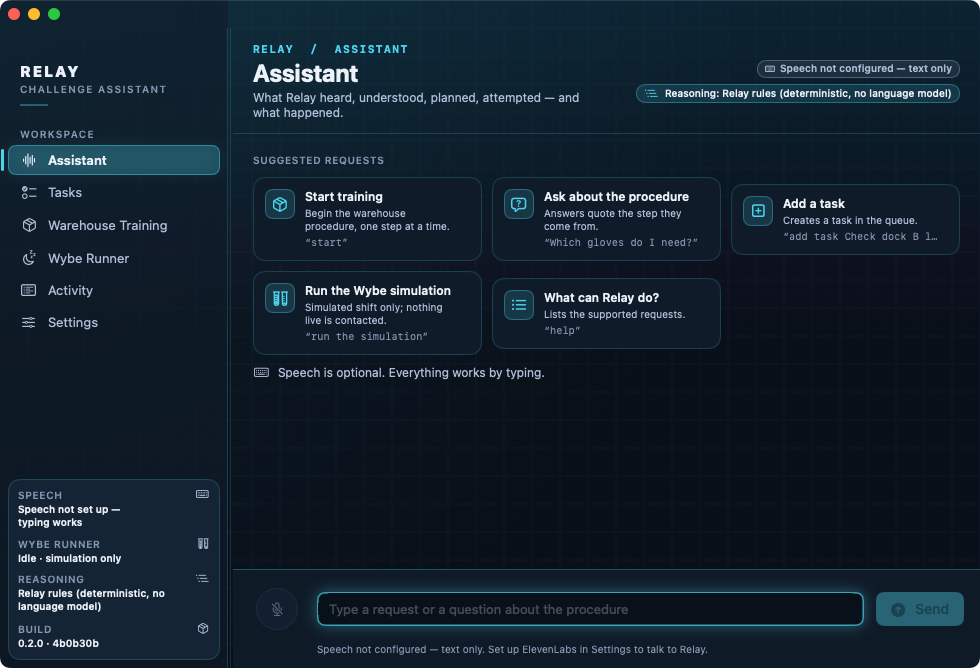
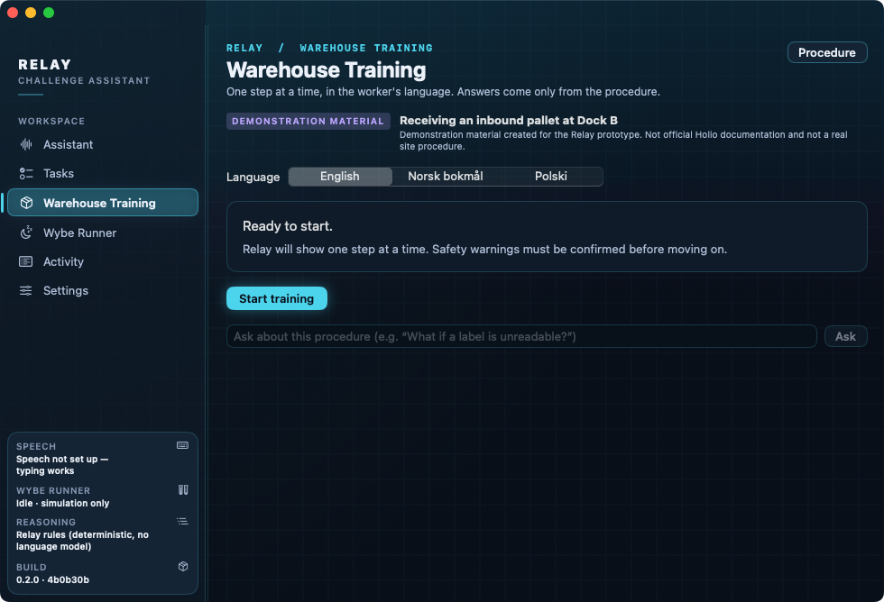
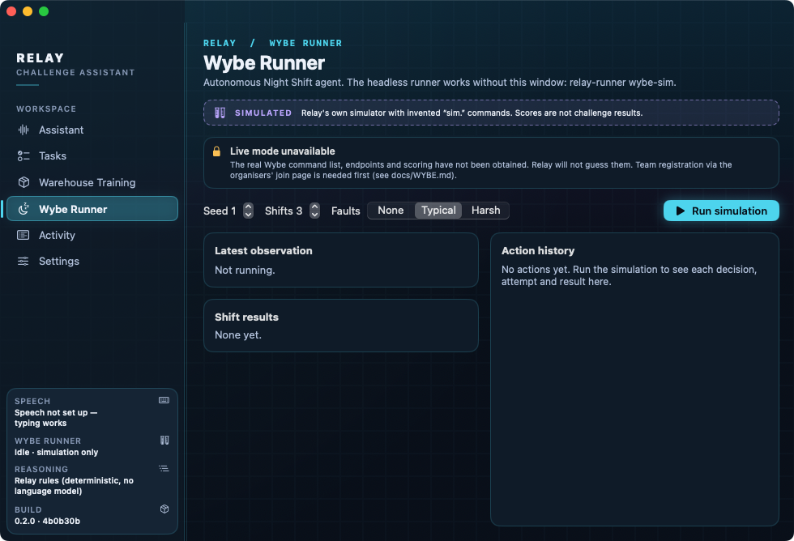
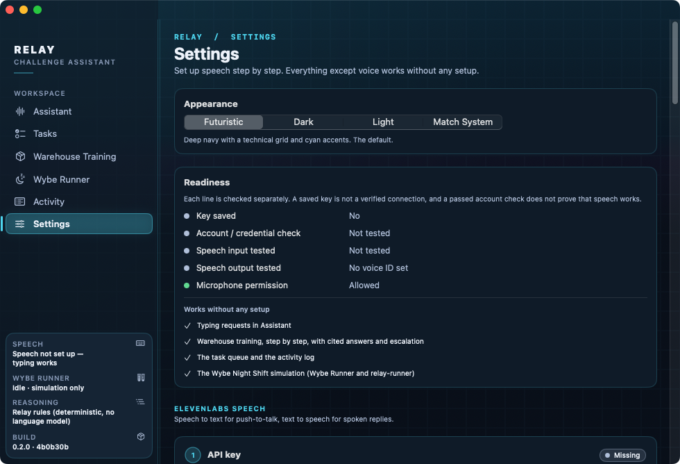
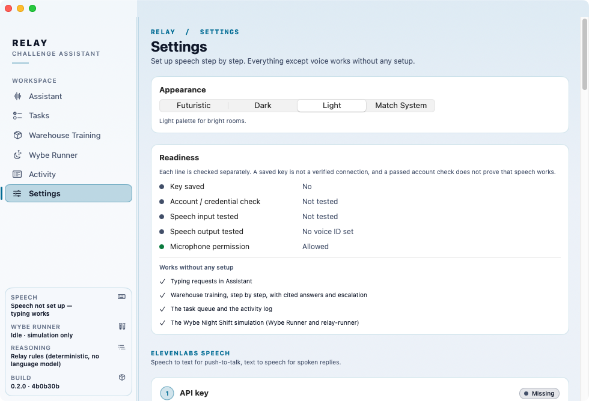

# Relay

Relay is a technical assistant for three Oslo Sprint side challenges: **Wybe Night Shift**,
**Holio warehouse operations** and **ElevenLabs**. It shows what it heard, what it understood,
what it plans to do, what it attempted, and what succeeded, failed or needs attention.

*Relay* is a working name. The project is self-contained in `relay/`, has no third-party
dependencies, and does not use or touch `distil/` (Distil).

> Eligibility for more than one challenge prize has **not** been confirmed. That is a
> question for the organisers.

## Screenshots

Real window captures of the packaged `Relay.app`, taken by the Relay workflow on GitHub's macOS runner, on a fresh install: no API key, no tasks and no simulation run.

**Assistant**: suggested requests and the typed request field. Speech is optional; everything works by typing. *Captured 8 November 2026.*



**Warehouse Training**: a synthetic Dock B procedure, one step at a time, in English, Norwegian Bokmål and Polish. *Captured 8 November 2026.*



**Wybe Runner**: simulation controls, clearly marked SIMULATED. Live mode is unavailable. *Captured 8 November 2026.*



<details>
<summary>More screens: Settings in both appearances (same run)</summary>

| | |
|---|---|
|  |  |
| **Settings** (no key saved) | **Settings**, Light appearance |

</details>

<sub>**Screenshot provenance:**
- Source: Relay workflow [run 42444109030](https://github.com/F1r3srp3nt/Oslo-Sprint/actions/runs/42444109030) on `main` at commit `4b0b30bd8f600a59b5a0816f8e75c5a48cc4ec30`, which includes the latest Relay code change (`daf6daa`, PR #11, with the Wybe Runner sidebar fix).
- Captured on 8 November 2026 (about 03:49 UTC). The app is version 0.2.0, and its Build card shows `4b0b30b`.
- The window is at its minimum size (980 points wide).
- The images are unedited copies of the CI artifact.</sub>

**Packaged builds** for the competition go in [`submissions/Relay/`](../submissions/Relay/README.md). That folder says whether a build has been uploaded and what was verified.

## Status of the first milestone

| Part | State |
|---|---|
| Core engine (tasks, log, redaction, runner, training) | Builds; 68 XCTests pass on Linux (Swift 6.0.3) |
| `relay-runner` CLI | Builds and runs on Linux; should be identical on macOS |
| Warehouse training (text) | Complete and deterministic, with a **synthetic** procedure in en / nb / pl |
| Wybe Night Shift | **Simulation only.** The live protocol hasn't been obtained, and live mode sends nothing |
| ElevenLabs STT / TTS adapters | Implemented and tested against a fake transport, and checked against elevenlabs.io docs (2026-11-07). **Never called the real service** (no key) |
| macOS SwiftUI app | Compiles on GitHub's macOS 15 runner, which also launches it for the [screenshots](#screenshots). **Not yet tried by a person on a Mac**; run `scripts/verify-macos.sh` |

## Continuous integration

`.github/workflows/relay.yml` runs on pull requests and pushes to `main` that touch `relay/`:

- **Linux** (`swift:6.0-noble`): build, the 68 tests, runner smoke tests (simulation only, no
  network) and the credential check.
- **macOS** (`macos-15`): build, including the SwiftUI app target, plus tests and the
  `Relay.app` bundle.

## Requirements

- macOS 14 or later with Xcode 15.3+ (Swift 5.9+) for the app.
- Any Swift 5.9+ toolchain (macOS or Linux) for the core, the tests and `relay-runner`.

## Build and run on a Mac

```bash
# Every script works from any folder and starts with a read-only check of the developer tools.
bash relay/scripts/check-prereqs.sh --tests  # macOS, Swift, developer directory, SDK, XCTest; prints exact fixes
bash relay/scripts/run-latest.sh             # package, quit any running Relay, open exactly build/Relay.app
bash relay/scripts/run-latest.sh --test      # same, but run the tests first and stop if they fail

cd relay
./scripts/test.sh                      # swift build + swift test; reports run/skipped/failed (needs Xcode's XCTest)
./scripts/build-app.sh                 # package only (microphone usage text, ad-hoc signed); no test targets
./scripts/verify-macos.sh --launch-check   # build + tests + Relay.app + launch check → build/verify-macos.log

# Or run straight from SwiftPM in Terminal (no bundle; mic permission is asked for Terminal)
swift run Relay

# Xcode: opening Package.swift and running the "Relay" scheme works for everything except
# push-to-talk — a bare executable has no Info.plist/NSMicrophoneUsageDescription, and macOS
# terminates apps that request the microphone without one. Use Relay.app (run-latest.sh or build-app.sh) for voice.
```

## Appearance (Futuristic skin)

Distil and Relay share one original design: a deep navy canvas with a faint technical grid, navy
panels with thin cyan borders, a filled teal sidebar selection with a cyan indicator, cyan breadcrumbs
above bold page titles, cyan primary buttons with dark text, and themed fields and secondary buttons.
**Futuristic** is the default appearance. Settings › Appearance also offers Dark (no grid or glow),
Light and Match System. Installations that were on "Match System" move to Futuristic once; an
explicit Dark or Light choice is kept. The sidebar's Build card shows which copy is running.
Drag the thin line at the sidebar's edge to resize it (200–290 points). The width is remembered, and
it shrinks automatically if the window is too narrow.

The skin has not yet been viewed on a Mac. Build, launch and check it with
`relay/docs/SKIN-VERIFICATION.md`.

The Relay workflow's macOS job also launches the built app and saves window captures of every
section (and Settings in Light) as the `relay-screenshots` artifact on each run. CI opens each
screen with `--screenshot-section <section>`; ordinary launches pass nothing.

## Headless runner (macOS or Linux)

```bash
cd relay
swift run relay-runner help
swift run relay-runner wybe-sim --shifts 10 --faults typical      # SIMULATED scores only
swift run relay-runner wybe-sim --seed 7 --faults harsh --verbose --json runs/sim.json
swift run relay-runner wybe-sim --stop-after 5                    # demonstrates the stop control
swift run relay-runner wybe-sim --stop-file /tmp/relay.stop       # touch the file to stop
swift run relay-runner wybe-live                                  # explains what's missing; sends nothing; exit 2
swift run relay-runner warehouse --lang pl                        # interactive text training
./scripts/demo-warehouse.sh                                       # scripted training session
swift run relay-runner export-procedure > my-procedure.json
```

Ctrl-C during `wybe-sim` stops before the next action. Pressing it a second time exits at once.

## Using the app

| Section | What it does |
|---|---|
| **Assistant** | Type, or hold the mic button to talk. A transcript is never acted on until you review it and press *Send transcript*. Each request shows a card with Heard / Understood / Plan / Attempted / Result. *Approve* or *Decline* appear for actions that need approval, and *Speak* / *Stop playback* control spoken replies. |
| **Tasks** | Queue with validated state changes: escalations, approvals and tasks you add. |
| **Warehouse Training** | Step card with critical warnings first, a language switcher, *I understand the safety warning* (required before *Next*), questions answered with the supporting instruction quoted, clarification, and escalation. |
| **Wybe Runner** | Seed, shift count, fault level, Run / Stop. Shows the latest observation, the current decision rationale, the full action history with attempts, and per-shift and average **SIMULATED** scores. Live mode is locked. |
| **Activity** | Redacted, append-only event log with filters and JSON Lines export. |
| **Settings** | Guided setup. A readiness panel shows five separate checks (key saved, account check, speech input tested, speech output tested, microphone permission). Numbered ElevenLabs steps cover the API key (Keychain: save, replace, remove), voice, microphone and speech input, and models, each with buttons that open the right dashboard page, explicit test buttons and expandable *Where do I find this?* / *Troubleshooting* help. It also explains reasoning honestly and has a Wybe registration link with an integration checklist. |

Text-only fallback: with no ElevenLabs key, everything except push-to-talk and spoken replies
works. The status pills read "Not configured — text only".

## What is simulated, what is real

- **Simulated:** the entire Night Shift environment (`SimulatedNightShift`), including its
  `sim.` command vocabulary, its tasks, its points and its faults. Every score it produces is
  labelled SIMULATED.
- **Synthetic:** the warehouse procedure and its translations. It is demonstration material,
  not Holio documentation.
- **Real but unexercised:** the ElevenLabs HTTP calls. They will run with your key, but have
  not run yet.
- **Not implemented, by design:** the live Wybe adapter, a Holio integration, and any
  language-model reasoning.

## Still needed from outside

1. **Wybe:** a team key from registration at `https://nightshift-board.wybe.me/join` (your call;
   Relay has registered nothing). The organisers' key card gives the endpoint
   (`https://nightshift.wybe.me/`) and `Authorization: Bearer <key>`. The JSON format, commands,
   observations, retry safety, limits and scoring must then be discovered with the key, and
   **the live adapter still has to be written**. See `docs/WYBE.md` and the checklist in Settings.
2. **ElevenLabs:** your API key (Settings, step 1, with the Speech to Text and Text to Speech
   permissions) and a voice ID (step 2). Instructions were checked against elevenlabs.io on
   2026-11-07; see `docs/ELEVENLABS.md`.
3. **Optional:** a language-model provider, if open-ended question answering is wanted
   (`docs/WAREHOUSE.md`).

## Acceptance checklist (Mac)

The full step-by-step sequence for the guided speech setup is in `docs/MACOS-ACCEPTANCE.md`. It covers
key saving, account check, voice and microphone tests, cancel/restart, changes while a request is
pending, persistence across restarts, and the minimum window width. The short list:

- [ ] `./scripts/test.sh` passes: 68 tests, and the `Relay` app target compiles.
- [ ] `./scripts/build-app.sh && open build/Relay.app` opens a dark window with six sections.
- [ ] Assistant, typed `start`: the card shows Heard / Understood / Plan / Attempted / Result, and Step 1/7 has the SAFETY line first.
- [ ] `next` asks for confirmation. `understood` and then `next` show Step 2/7.
- [ ] Training: a Polish question about a leak (`Co zrobić, gdy widzę wyciek?`) is answered in Polish with S3 quoted, after switching the language to Polski.
- [ ] `How do I handle frozen goods?` escalates, and a *Needs attention* task appears with a badge on Tasks.
- [ ] `run the simulation` waits for Approve. Decline cancels the task, and nothing runs.
- [ ] Wybe Runner, Run: the banner says SIMULATION, actions stream in, and Stop (⌘.) halts before the next action. Scores read "SIMULATED … not a challenge result".
- [ ] Settings, no key: the readiness panel shows "Key saved: No", the speech pills say "Not configured — text only", and the mic button is disabled. Typing still works.
- [ ] Settings › *Open API Keys*, *Open My Voices* and *Open Voice Library* open the ElevenLabs dashboard in the browser.
- [ ] Save a wrong key: "Key saved" turns Yes but nothing reads as verified. *Check account* then shows "ElevenLabs did not accept this API key (HTTP 401)", and the key appears nowhere in Activity or an export.
- [ ] Use a key without User (read): *Check account* shows what ElevenLabs actually returned. An explicit `insufficient_permissions` code shows "reports insufficient permissions" as needs-attention, naming a permission only if ElevenLabs' message names it. A bare 403 shows "refused access; the cause is not stated" and claims neither that the key is valid nor which permission is missing.
- [ ] Paste the API key into the voice-ID field: it is refused and not saved.
- [ ] Valid key and voice: *Test voice* plays the sample and marks "Speech output tested". *Test speech input* records 3 s and marks "Speech input tested". The account check stays a separate line.
- [ ] Changing the speech generation model resets "Speech output tested" to Not tested.
- [ ] Hold the mic in Assistant, speak, release, edit the transcript and send. The reply is spoken, and *Stop playback* stops it.
- [ ] Narrow the window to its minimum width: the Settings steps stack vertically and nothing is clipped.
- [ ] `./scripts/check-no-secrets.sh` passes.

## Third-party dependencies

None. Relay uses Foundation, SwiftUI, AppKit, AVFoundation, Security (Keychain) and XCTest
only. ElevenLabs is reached over its public REST API with `URLSession`, not through an SDK.

More detail: `docs/ARCHITECTURE.md`, `docs/WYBE.md`, `docs/WAREHOUSE.md`, `docs/ELEVENLABS.md`.
